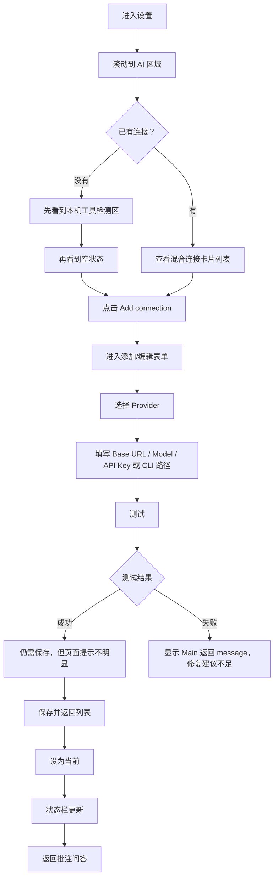

# Knowex AI 连接管理页面 UX 专项检查报告

检查日期：2026-07-29
检查范围：Renderer 设置页、AI 连接管理组件、状态栏、相关 CSS、Provider Presets、Preload/IPC 状态映射、Public DTO 与错误展示路径。
检查方式：已完整检查当前仓库真实代码；未进行实际 Electron 页面视觉操作。本环境没有可安全操作 Knowex 桌面窗口并读取 UI 状态的自动化工具，本报告不把任何未亲眼看到的页面状态标记为视觉验证。

## 1. 总体结论

当前 AI 连接管理页面已经具备完整功能入口：添加、编辑、删除、测试、设为当前、云端 API、本机 CLI 检测都能从代码路径上到达。但它更像“工程配置面板”，尚未达到普通用户可直接理解和稳定操作的 UX 水平。

是否达到可用状态：英文环境下对熟悉 API/CLI 的用户基本可用；中文环境下存在大面积乱码，普通用户不可用。

是否适合普通用户：不适合。主要障碍是技术字段暴露过多、云端 API 与本机工具层级混杂、错误提示缺少下一步建议、测试与保存关系不明确。

是否适合直接进入正式验收：不建议。建议先做一轮只改 Renderer、样式和文案的最小界面优化，再进入正式验收。

最大的三个体验问题：

1. 中文文案在 AI 页面和部分错误兜底中为乱码，直接阻断中文用户理解。
2. “测试成功”“已保存”“当前使用”“支持图片”四种状态没有清晰区分，用户容易误判连接是否真的可用于后续问答。
3. 本机 CLI 流程缺少面向普通用户的解释和路径选择帮助，尤其是 Windows `.cmd/.ps1` 被拒绝时，用户不知道应选择什么。

## 2. 当前用户流程



容易困惑或中断的位置：

- 在设置页中，AI 区域只是一个普通 section，入口不突出：`src/renderer/src/features/settings/SettingsDialog.tsx:45`。
- 第一次使用时，本机工具检测区排在空状态之前，用户可能以为必须先配置 CLI：`src/renderer/src/features/settings/ai/AIConnectionsPanel.tsx:122`。
- Provider 下拉同时包含云端 API 与本机 CLI，没有“云端 API / 本机工具”第一步分流：`src/renderer/src/features/settings/ai/AIConnectionEditor.tsx:80`。
- 普通 Provider 也显示 `Protocol`，暴露 OpenAI Responses / Chat Completions / Anthropic Messages 等协议词：`src/renderer/src/features/settings/ai/AIConnectionEditor.tsx:86`。
- 测试按钮和保存按钮并列，但没有说明测试不会自动保存：`src/renderer/src/features/settings/ai/AIConnectionEditor.tsx:117`。
- 卡片只显示“Last test passed/failed”，没有时间、测试对象和“仅代表上次文本测试”的提示：`src/renderer/src/features/settings/ai/AIConnectionCard.tsx:36`。

## 3. 问题清单

| ID | 严重级别 | 页面/组件 | 用户场景 | 当前问题 | 用户影响 | 代码位置 | 建议 |
| -- | ---- | ----- | ---- | ---- | ---- | ---- | -- |
| UX-001 | P1 | AI 页面中文文案 | A-J | AI 页面中文字符串大量乱码，例如“AI 杩炴帴”“娣诲姞杩炴帴”。 | 中文用户无法理解页面，主流程基本不可用。 | `src/renderer/src/features/settings/ai/AIConnectionsPanel.tsx:17`, `AIConnectionEditor.tsx:28`, `AIConnectionCard.tsx:18`, `AIConnectionTestResult.tsx:7`, `src/main/ai/provider-presets.ts:14` | 修复编码或替换为集中 i18n key；所有 AI 文案从 `translations.ts` 管理。 |
| UX-002 | P1 | 错误提示 | E/I | Renderer 只清理 IPC 前缀后直接展示错误 message。 | 401、429、CLI 未登录、路径无效等错误缺少用户可执行建议。 | `src/renderer/src/app/errors.ts:1`, `src/renderer/src/features/settings/ai/AIConnectionTestResult.tsx:12` | 增加错误码到用户文案的映射，区分“重试”“修改 Key”“检查 CLI 登录”。 |
| UX-003 | P1 | 本机工具添加 | I | 从检测区点击 Add 进入编辑页时传入 `id: ''` 的 connection，标题显示编辑而不是添加。 | 用户以为正在修改已有连接，尤其第一次添加 CLI 时很困惑。 | `src/renderer/src/features/settings/ai/AIConnectionsPanel.tsx:77`, `AIConnectionEditor.tsx:76` | 本机工具草稿使用独立 draft 类型，编辑器明确显示“添加 Codex CLI 连接”。 |
| UX-004 | P1 | CLI 路径 | I | 本机工具只提供可执行文件路径文本框，没有文件选择按钮或路径帮助。 | 普通 Windows 用户很难找到正确 `.exe`，容易填入 `claude.cmd` 或命令参数。 | `src/renderer/src/features/settings/ai/AIConnectionEditor.tsx:99`, `src/preload/index.ts:37` | 增加“选择文件”最小 IPC，或至少提供明确 `.exe` 示例、复制检测路径、终端验证命令。 |
| UX-005 | P1 | CLI 错误 | I | Main 会拒绝非直接可执行文件，但 UI 不解释 `.cmd/.ps1` 为什么不能用。 | 用户看到“path must point to executable file”后不知道该选什么。 | `src/main/ai/secure-process-runner.ts:160`, `AIConnectionTestResult.tsx:12` | 对 `LOCAL_TOOL_INVALID_PATH` 增加 Windows 说明：“请选择真实 .exe，不要选择 .cmd/.ps1/npm shim”。 |
| UX-006 | P2 | 信息架构 | A/J | 云端 API 连接、本机 CLI 检测、已有连接卡片混在同一层级。 | 第一次使用时不知道应该先选云端还是本机；多连接时当前连接不容易找到。 | `src/renderer/src/features/settings/ai/AIConnectionsPanel.tsx:113`, `:122`, `:146` | 增加“当前使用”摘要；列表按“云端 API / 本机工具”分组。 |
| UX-007 | P2 | 空状态 | A | 空状态在本机工具检测区之后出现。 | 用户第一次打开会先看到 CLI 检测，容易误以为 AI 只能走本机工具。 | `src/renderer/src/features/settings/ai/AIConnectionsPanel.tsx:122`, `:146` | 无连接时先显示空状态和“添加云端 API / 添加本机工具”两个入口，再显示检测区。 |
| UX-008 | P2 | 添加连接 | A/B/I | Add connection 直接进入完整表单，Provider 下拉包含所有预设。 | 普通用户要在 OpenAI、Custom、Codex CLI、Claude Code CLI 中自己理解类别。 | `src/renderer/src/features/settings/ai/AIConnectionEditor.tsx:80` | 添加第一步选择：“云端 API”或“本机工具”，再进入对应表单。 |
| UX-009 | P2 | Provider/Transport | B/C | 普通厂商显示只读 Protocol 字段。 | 用户被迫看到不需要理解的协议名，可能把协议当作必须配置项。 | `src/renderer/src/features/settings/ai/AIConnectionEditor.tsx:86` | 仅 Custom 显示 Protocol；普通厂商改成帮助文本或隐藏。 |
| UX-010 | P2 | Custom Base URL | B | Base URL 示例是完整 endpoint，例如 `/v1/chat/completions`，但字段名只写 Base URL。 | 中转站用户不知道应填根地址还是完整接口地址。 | `src/main/ai/provider-presets.ts:76`, `AIConnectionEditor.tsx:105` | 字段改名为“接口地址”，按 transport 显示示例，并说明不要填 Authorization。 |
| UX-011 | P2 | 图片能力 | B/C/G | Capabilities 对普通云端 Provider 可直接勾选，文案只写 Text/Images。 | 用户可能误以为勾选图片等于已验证图片能力。 | `src/renderer/src/features/settings/ai/AIConnectionEditor.tsx:110` | 普通 Provider 使用预设能力只读展示；Custom 放入高级设置，并标注“声明能力，测试连接只验证文本”。 |
| UX-012 | P2 | 测试与保存 | D/E | 测试按钮和保存按钮并列，测试成功后没有“还需要保存”的提示。 | 用户可能测试成功后取消或关闭，误以为连接已保存。 | `src/renderer/src/features/settings/ai/AIConnectionEditor.tsx:117`, `AIConnectionTestResult.tsx:10` | 测试结果旁显示“测试不会自动保存；请点击保存”。保存成功后返回列表并给具体 toast。 |
| UX-013 | P2 | 测试结果 | E/G | 测试结果只显示 passed/failed、message、latency。DTO 有 checkedAt/provider/model 但 UI 不展示。 | `lastTest` 可能造成“以前成功等于现在可用”的误导。 | `src/shared/domain/settings.ts:41`, `AIConnectionTestResult.tsx:10`, `AIConnectionCard.tsx:36` | 显示测试时间、模型、协议，并写明“仅为上次文本连通性测试”。 |
| UX-014 | P2 | 设置当前 | F | 未配置 Key 或路径无效的连接仍可点击 Set current。 | 用户可能切到不可用连接，后续问答才失败。 | `src/renderer/src/features/settings/ai/AIConnectionCard.tsx:39`, `src/main/ai/ai-connection-service.ts:106` | UI 禁用或二次提示；文案说明“可保存但未配置，无法用于问答”。 |
| UX-015 | P2 | 状态栏 | F | 状态栏只显示 `name · model` 或 AI not configured；CLI 无模型时可能空尾巴。 | 用户无法判断当前连接类型、是否缺 Key、是否仅文本。 | `src/renderer/src/app/App.tsx:44`, `src/renderer/src/app/App.tsx:202` | 状态栏显示“OpenAI / model / 支持图片”或“Claude CLI / 已配置 / 仅文本”。 |
| UX-016 | P2 | 删除确认 | H/I | 删除确认始终说会删除 API Key，对 CLI 连接不准确；不说明 active fallback 或最后一个连接后果。 | 用户对删除本机工具连接、当前连接、最后连接的影响不清楚。 | `src/renderer/src/features/settings/ai/DeleteConnectionDialog.tsx:14` | 根据连接类型、active 状态和剩余数量生成确认文案。 |
| UX-017 | P2 | 删除按钮 | H/J | Delete 按钮在卡片上长期暴露，并与 Test/Edit/Set current 同层。 | 多连接页面容易误触危险操作。 | `src/renderer/src/features/settings/ai/AIConnectionCard.tsx:42` | 将删除移到编辑页或更多菜单；保持二次确认。 |
| UX-018 | P2 | 本机检测状态 | I | 卡片直接展示 `localToolStatus` 枚举，例如 `not-authenticated`。 | 用户看到内部状态词，不知道下一步是登录、换路径还是升级。 | `src/renderer/src/features/settings/ai/AIConnectionCard.tsx:33`, `src/shared/domain/settings.ts:15` | 把状态枚举映射为本地化短句和修复建议。 |
| UX-019 | P2 | 忙碌状态 | E/J | `busy` 是全局单一状态，检测、测试、保存、删除、切换都会禁用整个面板。 | 一个连接测试中，其他操作全部不可用，用户不知道哪个操作正在进行。 | `src/renderer/src/features/settings/ai/AIConnectionsPanel.tsx:39`, `:54`, `:70` | 改为按操作/连接粒度的 loading 状态；按钮显示“Testing...”。 |
| UX-020 | P2 | 多连接列表 | J | 所有连接用等高卡片纵向堆叠，无分组、筛选、当前置顶或折叠。 | 五个以上连接时需要滚动寻找当前连接，操作按钮重复造成视觉密度高。 | `src/renderer/src/features/settings/ai/AIConnectionsPanel.tsx:146`, `src/renderer/src/styles/dialogs.css:20` | 当前连接摘要置顶；列表分组；卡片压缩为两行信息，次要操作收起。 |
| UX-021 | P2 | 长文本 | J/I | 模型名、连接名、CLI 路径缺少完整查看/复制；检测行只用 ellipsis。 | 长模型和长路径可能看不到关键尾部，用户难以确认路径是否正确。 | `src/renderer/src/styles/dialogs.css:39`, `src/renderer/src/styles/dialogs.css:41`, `AIConnectionCard.tsx:24` | 长文本中间截断，hover/title 或复制按钮；CLI 路径单独 code 展示。 |
| UX-022 | P3 | 设置页入口 | A | Settings 中 AI 区域标题只是 `AI`，与其他设置在一个长弹窗中。 | 用户需要滚动查找，AI 连接管理不像一个完整管理页。 | `src/renderer/src/features/settings/SettingsDialog.tsx:45`, `src/renderer/src/styles/dialogs.css:1` | 设置页增加左侧/顶部分类或至少给 AI 区域加说明和锚点。 |
| UX-023 | P3 | 文案一致性 | A-J | AI 组件使用局部 language 条件，不走全局 `t()`；同一概念可能散落多处。 | 后续中文/英文调整容易不一致。 | `AIConnectionsPanel.tsx:17`, `AIConnectionEditor.tsx:20`, `AIConnectionCard.tsx:17` | 迁入 `src/renderer/src/i18n/translations.ts`，统一术语表。 |
| UX-024 | P3 | 视觉层级 | J | CSS 用小字号 badges 与多个按钮，卡片主次差异不够强。 | 页面功能完整但扫描成本高。 | `src/renderer/src/styles/dialogs.css:21`, `:27`, `:29` | 当前连接 badge 更醒目；测试状态弱化为次要信息；主操作只保留一个。 |
| UX-025 | P3 | 键盘/关闭行为 | D/H | 组件没有显式处理 Esc、Enter 是否提交、焦点回到触发按钮。 | 键盘用户容易失去上下文，回车可能触发非预期按钮。 | `SettingsDialog.tsx:21`, `AIConnectionEditor.tsx:117`, `DeleteConnectionDialog.tsx:23` | 明确焦点管理；删除确认默认焦点在取消；Enter 不触发危险操作。 |

### 字段级检查

| 字段 | 普通用户是否需要看到 | 默认展示建议 | 当前名称是否清楚 | 当前风险 | 建议 |
| -- | -- | -- | -- | -- | -- |
| 连接名称 | 需要 | 展示 | 基本清楚 | Provider 名、模型名、连接名容易混淆 | placeholder 示例：“我的 OpenAI 中转站”。 |
| Provider | 需要 | 展示 | 英文环境偏技术，中文目前乱码 | 云端和 CLI 混在一个下拉 | 改为“服务类型/服务商”，先分云端 API、本机工具。 |
| Transport | 普通厂商不需要；Custom 需要 | 仅 Custom 高级设置 | 不清楚 | 暴露内部协议词 | 普通厂商隐藏，Custom 显示并给说明。 |
| Base URL | Custom/中转站需要；官方用户可默认 | 官方折叠或只读；Custom 展示 | “Base URL”不够清楚 | 不知道根地址还是 endpoint | 改为“接口地址”，给对应协议示例。 |
| Model | 需要 | 展示 | 基本清楚 | 不知道常用模型格式 | 增加示例/最近使用，不写死完整列表。 |
| API Key | 云端需要 | 展示 | 基本清楚 | 留空保留提示不够醒目 | 编辑页显示“已保存密钥；留空不会覆盖”。可加显示/隐藏按钮。 |
| 文本能力 | 普通用户不需要配置 | 展示为只读状态 | “Text”过短 | 用户可能取消导致不可用 | 普通 Provider 固定展示；Custom 高级设置可调。 |
| 图片能力 | 用户需要知道，普通用户不应随意声明 | 展示状态，Custom 高级可调 | “Images”不说明含义 | 误以为测试已验证图片 | 写成“声明支持截图/图片”，并区分测试结果。 |
| 可执行文件路径 | CLI 用户需要 | CLI 表单展示 | 基本清楚但缺 Windows 说明 | 容易填 `.cmd/.ps1` 或带参数命令 | 加文件选择、`.exe` 说明、终端验证建议。 |
| CLI 版本 | 需要知道 | 卡片/测试结果展示 | 目前混在副标题 | 路径和版本不可复制 | 显示为独立状态行。 |
| 最后测试状态 | 需要 | 展示但弱化 | “Last test passed”不完整 | 误以为仍然可用或图片也通过 | 显示时间、文本测试、模型。 |
| 当前连接状态 | 强烈需要 | 页面顶部摘要 | 当前卡片 badge 有，但不够突出 | 多连接时难找 | 增加“当前使用”固定摘要。 |

### 错误提示专项

当前错误从 Main Process 生成，例如 `AUTHENTICATION_FAILED`、`REQUEST_TIMEOUT`、`LOCAL_TOOL_INVALID_PATH`，但 Renderer 的 `toUserMessage` 只返回 `error.message`，测试结果组件也直接显示 `result.message`。这意味着错误本身没有泄漏密钥，但缺少面向用户的行动建议。

| 错误 | 当前表现 | UX 风险 | 建议 |
| -- | -- | -- | -- |
| 没有当前连接 | 显示 Main message 或状态栏 AI not configured | 不知道去哪里配置 | 给“打开设置 > AI 连接 > 添加连接”。 |
| API Key 未填写 | Main 返回 credential missing | 不知道编辑时留空和新增留空区别 | 新增连接明确要求 Key；编辑留空保留旧 Key。 |
| API Key 错误 / 401 / 403 | “Authentication failed...” | 可理解但不够本地化 | 建议检查 Key、账户权限、Base URL 是否匹配。 |
| Base URL 错误 | 多半网络错误或 provider unavailable | 用户不知道是地址格式还是服务不可达 | 区分 URL 格式、本机网络、服务商状态。 |
| 模型不存在 | 可能落入 provider error | 容易显示技术 JSON 摘要 | 建议检查模型名是否对当前服务商开放。 |
| 余额不足 | 可能落入 provider error | 用户不知道是账户问题 | 增加按错误码或状态文本映射。 |
| 限流 429 | `RATE_LIMITED` | 需要知道等待或换模型 | 提示稍后重试、检查额度/频率。 |
| 超时 | `REQUEST_TIMEOUT` 或 local timeout | 可理解但无下一步 | 提示检查网络、服务商状态、CLI 是否卡住。 |
| 网络错误 | `NETWORK_ERROR` | 容易以为 Knowex 故障 | 提示检查代理、防火墙、Base URL。 |
| 响应格式错误 | `INVALID_RESPONSE` | 技术化 | 提示服务商接口协议可能选错。 |
| 图片不支持 | `IMAGE_NOT_SUPPORTED` | 需要引导切换连接 | 明确“当前连接仅文本，请切换到支持图片的连接”。 |
| CLI 未安装 | local detection message | 若检测区隐藏在滚动中不明显 | 提示先在终端安装并确认命令可运行。 |
| CLI 路径无效 | raw message | 不知道 `.exe` 要求 | 提示选择真实 `.exe`，不要选 shim 或带参数。 |
| CLI 未登录 | raw enum/message | 不知道 Knowex 不保存 token | 提示在终端运行对应登录命令，Knowex 不读取 token。 |
| CLI 输出为空/过大/取消 | raw message | 不知道重试还是设置问题 | 分别提示重试、缩短问题、取消已完成。 |

## 4. 优先修复建议

### 必须在正式验收前修复

- UX-001：修复中文乱码。否则中文用户无法完成配置。
- UX-002：建立错误码到用户可读建议的映射，至少覆盖认证、限流、超时、网络、图片不支持和 CLI 路径/登录。
- UX-003：修复本机工具从检测区添加时显示“编辑”的问题。
- UX-004 / UX-005：补足 CLI 路径选择或 `.exe` 说明，避免 Windows 用户卡在 shim 路径。
- UX-012：明确“测试成功不等于保存成功”。

### 建议在 RC 阶段修复

- UX-006 / UX-007 / UX-008：重排信息架构，增加当前连接摘要和云端/本机分流。
- UX-009 / UX-011：隐藏普通厂商的协议字段，把能力配置改成只读状态或高级设置。
- UX-013 / UX-015：增强测试结果和状态栏的信息。
- UX-016 / UX-017：优化删除确认和删除入口。
- UX-018：本地化 CLI 状态枚举。

### 可以后续处理

- UX-020：五个以上连接的分组、筛选、折叠。
- UX-021：长路径和长模型名的复制/展开。
- UX-022：设置页整体分类导航。
- UX-023：i18n 重构到统一翻译表。
- UX-024 / UX-025：视觉密度和键盘焦点优化。

## 5. 推荐目标页面

### 设置页 AI 区域

```text
AI 连接
管理用于批注问答的云端 API 和本机工具。API Key 只在本机加密保存；CLI 登录由工具自己管理。

当前使用
[OpenAI 中转站]  gpt-4.1  云端 API · 支持文本和图片 · 上次文本测试：今天 14:20 成功
[测试] [编辑] [切换]

云端 API
[OpenAI] [DeepSeek] [MiniMax] [Custom]
[添加云端 API]

本机工具
Codex CLI     未可用：检测到 Windows shim，请选择 codex.exe
Claude Code   可用：2.1.163
[重新检测] [添加本机工具]
```

### 连接列表

```text
OpenAI 中转站
OpenAI · gpt-4.1 · 云端 API
已保存 API Key · 支持文本和图片 · 上次文本测试成功 14:20
当前使用
[测试] [编辑] [...]

MiniMax 文本
MiniMax · MiniMax-Text-01 · 云端 API
已保存 API Key · 仅文本 · 上次文本测试失败：认证失败
[设为当前] [测试] [编辑] [...]
```

### 添加连接第一步

```text
添加 AI 连接

你想使用哪种方式？

[云端 API]
OpenAI、Anthropic、DeepSeek、Kimi、MiniMax 或中转站。需要 API Key，Knowex 会本机加密保存。

[本机工具]
调用电脑里已经安装并登录的 Codex CLI 或 Claude Code CLI。Knowex 不读取或保存 CLI Token。
```

### 云端 API 编辑页

```text
添加云端 API 连接

服务商：OpenAI
连接名称：我的 OpenAI
模型：gpt-4.1
API Key：••••••
接口地址：https://api.openai.com/v1/responses

高级设置
协议：OpenAI Responses
能力：文本、图片

[测试连接]  测试只验证文本连通性，不会自动保存。
[取消] [保存]
```

### 本机工具编辑页

```text
添加本机工具连接

工具：Claude Code CLI
可执行文件：C:\...\claude.exe   [选择文件]
版本：2.1.163
模型：sonnet（可选）

Knowex 不读取 CLI Token。请先在终端确认 claude --version 和登录状态。
当前仅支持文本，不支持截图批注。

[测试工具] [取消] [保存]
```

### 测试结果

```text
文本测试成功
服务商：OpenAI
模型：gpt-4.1
耗时：824 ms
时间：2026-07-29 14:20

测试不会自动保存。请点击保存后再设为当前。
```

### 删除确认

```text
删除“MiniMax 文本”？

这会删除本机保存的连接信息和对应加密密钥。此操作无法撤销。
它不是当前连接，删除后不会影响当前问答。

[取消] [删除]
```

当前连接删除时：

```text
这是当前使用的连接。删除后 Knowex 会自动切换到下一个可用连接；如果没有其他连接，AI 问答将不可用。
```

CLI 删除时：

```text
这会删除本机工具连接配置。Knowex 不保存 CLI Token，因此不会影响 CLI 自身登录状态。
```

### 空状态

```text
当前尚未配置 AI 连接

添加一个云端 API 或本机工具后，才能在批注中向 AI 提问。
API Key 只在本机加密保存；本机 CLI Token 由 CLI 自己管理。

[添加云端 API] [添加本机工具]
```

### 错误状态

```text
认证失败

服务商拒绝了请求。请检查 API Key 是否正确、账户是否有权限，以及接口地址是否属于同一服务商。

[编辑连接] [重新测试]
```

## 6. 建议修改文件

需要修改的现有文件：

- `src/renderer/src/features/settings/ai/AIConnectionsPanel.tsx`：重排当前连接摘要、空状态、云端/本机分组；修复本机工具添加草稿状态；增加操作级 loading。
- `src/renderer/src/features/settings/ai/AIConnectionEditor.tsx`：隐藏普通 Provider 的 Transport；增强 API Key 留空说明；增加测试不保存提示；调整能力字段层级；增加 CLI 路径帮助。
- `src/renderer/src/features/settings/ai/AIConnectionCard.tsx`：减少卡片按钮密度；本地化 `localToolStatus`；显示上次测试时间；避免长名称溢出。
- `src/renderer/src/features/settings/ai/AIConnectionTestResult.tsx`：显示 provider、model、checkedAt、latency；按 errorCode 显示下一步建议。
- `src/renderer/src/features/settings/ai/DeleteConnectionDialog.tsx`：按云端/CLI、当前/非当前、最后一个连接生成删除文案。
- `src/renderer/src/features/settings/SettingsDialog.tsx`：AI 区域标题与说明增强；必要时提供设置分区导航。
- `src/renderer/src/app/App.tsx`：状态栏显示连接类型、模型、配置状态和能力摘要。
- `src/renderer/src/app/errors.ts`：加入错误码/消息到用户文案的映射，保留敏感信息脱敏。
- `src/renderer/src/i18n/translations.ts`：集中维护 AI 页面中英文文案，修复乱码。
- `src/renderer/src/styles/dialogs.css`：连接列表分组、当前摘要、长文本截断、按钮层级、错误状态、小窗口适配。

建议新增或拆分的组件：

- `AIConnectionCurrentSummary.tsx`：当前连接摘要。
- `AIConnectionProviderStep.tsx`：添加连接第一步，区分云端 API 与本机工具。
- `AICloudConnectionForm.tsx`：云端 API 表单。
- `AILocalToolConnectionForm.tsx`：CLI 表单。
- `AIConnectionStatusBadge.tsx`：统一 configured、active、capabilities、lastTest 状态展示。
- `AIErrorAdvice.tsx` 或 `aiErrorMessages.ts`：错误码到建议文案。

只涉及样式：

- `src/renderer/src/styles/dialogs.css`。

涉及状态逻辑：

- `AIConnectionsPanel.tsx`、`AIConnectionEditor.tsx`、`AIConnectionCard.tsx`、`App.tsx`。

涉及文案：

- 所有 `src/renderer/src/features/settings/ai/*.tsx`、`translations.ts`、必要时 `provider-presets.ts` 的 helpText。

可能涉及 Main/IPC 的最小项：

- 如果增加“选择可执行文件”按钮，需要新增受限 dialog IPC，只允许选择本地文件，不允许 Renderer 指定任意参数。
- 如果错误提示需要稳定 errorCode，确认 `AIConnectionTestPublic.errorCode` 已足够；当前 DTO 已包含该字段。

不需要修改：

- Connector、CredentialStore、ConfigStore V2、ProviderRegistry、SecureProcessRunner 的核心执行逻辑。
- PDF、批注、Workspace、Markdown、Zotero 领域模块。

## 7. 最小优化方案

目标是不重构 AI 底层架构，只做页面可理解性和误操作防护：

1. 修复 AI 页面所有中文乱码，把局部文案迁入 `translations.ts`。
2. 在 `AIConnectionsPanel` 顶部新增当前连接摘要；无连接时把空状态放在第一屏。
3. 添加连接改成两步：先选“云端 API / 本机工具”，再进入现有编辑器；底层保存输入不变。
4. 普通 Provider 隐藏 Transport 字段，只在 Custom 的高级设置里显示。
5. 能力字段改为“支持文本 / 声明支持图片”，普通 Provider 默认只读，Custom 高级可编辑。
6. 测试结果增加“测试不会自动保存”和 checkedAt/model/latency 展示。
7. 根据 `errorCode` 增加本地化建议文案，特别是认证失败、限流、超时、图片不支持、CLI 路径无效、CLI 未登录。
8. 删除确认按连接类型和 active 状态调整文案；删除按钮移到更多菜单或编辑页。
9. 状态栏补充当前连接类型和未配置原因。
10. 保持 IPC、Connector、CredentialStore、Config V2 和 ProviderRegistry 不变；如需文件选择，只新增最小受限 IPC。

## 8. 验收清单

- 第一次打开：无连接时第一屏能看到“添加云端 API / 添加本机工具”，并能理解 API Key 本机加密、CLI Token 不由 Knowex 保存。
- 添加 OpenAI：默认字段清楚；无需理解 Transport；能填写模型和 Key；测试成功后知道还要保存。
- 添加 Custom：能看到协议、接口地址示例、模型示例和能力声明说明。
- 添加本机 CLI：能理解这是电脑中已有工具；路径要求清楚；`.cmd/.ps1` 被拒绝时知道选择 `.exe`。
- 编辑并保留旧 Key：API Key 输入框为空时明确显示“已保存密钥，留空不会覆盖”。
- 测试连接：测试中按钮显示 loading 且防止重复点击；成功显示时间、模型、耗时；失败显示下一步建议。
- 设置当前连接：当前连接摘要和卡片状态即时更新；未配置连接不能被无提示设为当前。
- 图片能力限制：仅文本连接显示“不能处理截图批注”；图片请求被阻止时提示切换到支持图片的连接。
- 删除连接：二次确认包含连接名称；删除当前连接说明回退；删除最后一个连接说明 AI 将不可用；CLI 删除不提 API Key。
- 多连接状态：五个以上连接时当前连接容易找到；云端 API 与本机工具分组；按钮不过密。
- 中英文：所有 AI 文案无乱码；同一概念中英文意义一致。
- 小窗口：按钮换行不重叠；长模型名、长连接名、长路径不撑破布局。
- 键盘操作：Tab 顺序合理；Esc 关闭非危险弹窗；删除确认默认焦点在取消；Enter 不触发删除。
- 错误提示：认证、Key 缺失、Base URL、模型、余额、限流、超时、网络、图片不支持、CLI 未安装、路径无效、未登录、输出为空/过大/取消都有明确下一步。
